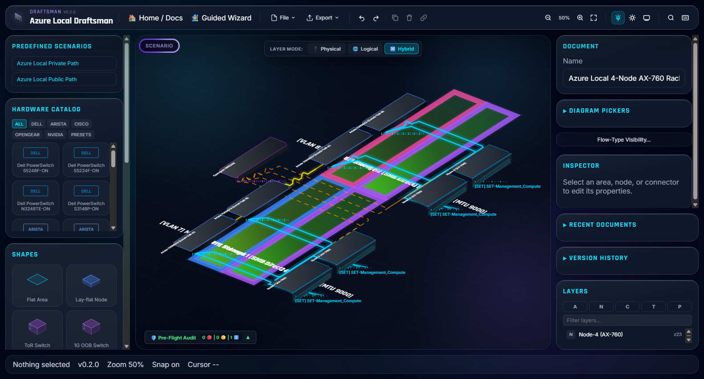

# Azure Local Draftsman

[](https://github.com/AzureLocal/azurelocal-draftsman/actions/workflows/ci-pages.yml)
[](LICENSE)

**Azure Local Draftsman is a free, browser-based cabling and compliance diagramming tool for Azure Local network architectures.** Draw the servers, top-of-rack (ToR) and out-of-band (OOB) switches, pin-level cables, VLANs and Network ATC intents of a cluster on a 2.5D isometric canvas, let the auditor check the design against the Microsoft Learn network patterns, and export the cable schedule and the switch port map your technicians and network engineers work from.

> No sign-up. No server. Everything runs in your browser; diagrams stay in your browser storage until you export them.

**Open it: <https://azurelocal.cloud/azurelocal-draftsman/>** (documentation: <https://azurelocal.cloud/azurelocal-draftsman/docs/>)

The Learn references were checked against Azure Local 12.2611 (latest, 12.2611.1004.9, OS build 26100.33822); its release notes change no cabling, network pattern or Network ATC rule.



## What it does

| Area | Capability |
|------|------------|
| **Design** | Dell, Arista, Cisco, Nvidia and Opengear hardware profiles with real port groups; pin-level cables (DAC, MMF, SMF, Cat6A, RS-232) with VLAN tags; SET teams; logical networks (VLAN, CIDR, MTU). |
| **Patterns** | Switched storage on one MLAG ToR pair, switchless storage (1 to 4 nodes), and rack-aware clusters (two zones). |
| **Network ATC** | Per-host intents: group-all, management plus compute with a dedicated storage intent, or disaggregated (three intents). |
| **Wizard** | Generates a fully cabled, audit-clean design for 2 and 3 node switchless, 4 and 8 node switched, and 4 and 8 node rack-aware clusters. Step 1 can **Start from your infrastructure.yml**: the node count, topology, storage connectivity, Network ATC intents, VLANs, storage MTU, server model and ToR switches are read from the environment's file (azurelocal-toolkit, schema 5); the file is read in the browser and never uploaded or written. |
| **Auditor** | 16 pattern-aware rules, each linked to its Microsoft Learn source, shown live as canvas badges and in the audit drawer. See [compliance-auditor](docs/compliance-auditor.md). |
| **Exports** | Cable schedule CSV, switch port map TXT, draw.io (`.drawio`), PNG, SVG, PDF, interactive HTML and JSON. |

### Network ATC defaults the tool follows

Network ATC assigns storage VLANs 711, 712, 713 and up by default (10.71.1.0/24, 10.71.2.0/24, 10.71.3.0/24). Draftsman uses those for storage, so a diagram matches what Network ATC will configure. Management and compute VLANs are not set by Network ATC; the tool ships example values (7 and 8) and warns, without blocking, when you put a non-storage network on 711 to 719. See [Network ATC intents](docs/network-atc-intents.md).

## Where Draftsman fits in the Azure Local tool chain

Draftsman is a **planning and documentation** tool: it draws the cabling, VLANs and Network ATC intents of the cluster. It reads the environment's `infrastructure.yml` and writes nothing back; its output is drawings and schedules for people.

```text
Surveyor (sizing handoff) -> Trailwright (infrastructure.yml) -> Draftsman (cabling diagram, schedules) -> hardware discovery -> ZTP -> toolkit deploy
```

| Direction | What | Name |
|---|---|---|
| In | The environment file Trailwright wrote | `infrastructure.yml` (schema 5), chosen in the wizard's step 1: `nodes[]`, `scenario.topology`, `scenario.storage_connectivity`, `networking.intents[]`, `networking.vlans[]`, `networking.management.vlan_id`, `networking.storage.networks[]`, `hardware.model`, `network_devices[]` ([how each answer is read](docs/guided-setup-wizard.md#start-from-your-infrastructureyml)) |
| Out | The diagram and its schedules | `.drawio`, PNG, SVG, PDF, interactive HTML and JSON; the cable schedule CSV and the switch port map TXT |

The design you draw and the file the toolkit deploys from describe the same VLANs and intents, so change them in `infrastructure.yml` first (Trailwright) and draw from it, not the other way round. See also [Trailwright's draw.io export](docs/drawio-export.md).

## Prerequisites

Draftsman is a browser app. It needs no Azure subscription, no PowerShell, no credentials and no access to nodes, switches or Active Directory. Designs stay in the browser (the working document is kept in browser local storage) and are exported to files you save yourself.

| Area | Requirement |
|---|---|
| To use the app | A current desktop browser with JavaScript enabled. The hosted site loads the Inter and Rajdhani fonts from Google Fonts, so a locked-down network needs `fonts.googleapis.com` and `fonts.gstatic.com` or accepts the fallback fonts |
| To build or develop | Node.js 22 LTS (CI uses 22; ESLint 10 needs 20.19 or later, Vite 6 and Vitest 3 need 18 or later) and npm. Git to clone |
| Install | `npm ci` (the repo sets `legacy-peer-deps=true` in `.npmrc`) |
| Dev server | Port 8125 on localhost (`npm run dev`) |
| Docs site build | `npm run build:site` also builds the VitePress docs in `docs/` (installed separately: `npm --prefix docs ci`) |
| Operating system | Any OS that runs Node 22 and a modern browser |
| Network (build) | HTTPS to the npm registry (`registry.npmjs.org`) for `npm ci` |
## Run it locally

```bash
git clone https://github.com/AzureLocal/azurelocal-draftsman.git
cd azurelocal-draftsman
npm ci
npm run dev          # http://localhost:8125/
```

After you pull a version that added the wizard's infrastructure.yml reader, run `npm ci` (or `npm install`) again: it needs the `yaml` package, which an older `node_modules` does not have.

```bash
npm run lint         # ESLint
npm test             # Vitest
npm run build        # type check + Vite build into dist/ (base /azurelocal-draftsman/)
npm run build:site   # app + VitePress docs assembled for GitHub Pages (docs under /docs/)
```

Pushes to `main` run the `ci-pages` workflow (lint, test, audit, build) and deploy the assembled site to GitHub Pages.

## Architecture

```
src/
├── app/                  # Shell layout (top toolbar, status bar)
├── features/
│   ├── canvas/           # Viewport, overlays, renderers (switch, server, OOB, connector, area)
│   ├── export/           # Cable schedule CSV, switch port map, draw.io, PNG/SVG/PDF/HTML/JSON
│   ├── inspector/        # Property editor, Network ATC intent editor
│   ├── palette/          # Hardware palette and preset stacks
│   ├── validation/       # Auditor (rules/ = one module per rule group) and audit drawer
│   ├── wizard/           # Guided setup and the pure topology builder
│   └── ...               # layers, templates, landing page, traffic-flow scenarios (upstream)
├── lib/
│   ├── geometry/         # Isometric projection, anchors, routing
│   ├── serialization/    # Document storage, normalization and migration
│   └── topology/         # Pure analysis helpers shared by the rules
├── state/                # Zustand store, undo/redo
└── types/                # Document model, hardware profiles, cabling, topology, validation
```

The document stores flat logical coordinates; isometric projection happens only when rendering. The auditor, wizard builder and exporters are pure functions of the document, which is what makes them unit-testable.

## Origin and licence

Draftsman started as a fork of **[AzLoFlows](https://github.com/CristianEdwards/AzLoFlows)** by Cristian Edwards Sabathe (MIT). The isometric canvas, projection helpers, visual tokens and the scenario-based traffic-flow diagrams (still available under Templates and Scenarios) come from that project. This repository narrows the product to cabling and compliance for Azure Local. The original copyright notice and the MIT licence are kept in [LICENSE](LICENSE).

## Contributing and security

See [CONTRIBUTING.md](CONTRIBUTING.md) and [SECURITY.md](SECURITY.md). Agent and tooling conventions are in [AGENTS.md](AGENTS.md).

## License

[MIT](LICENSE).
